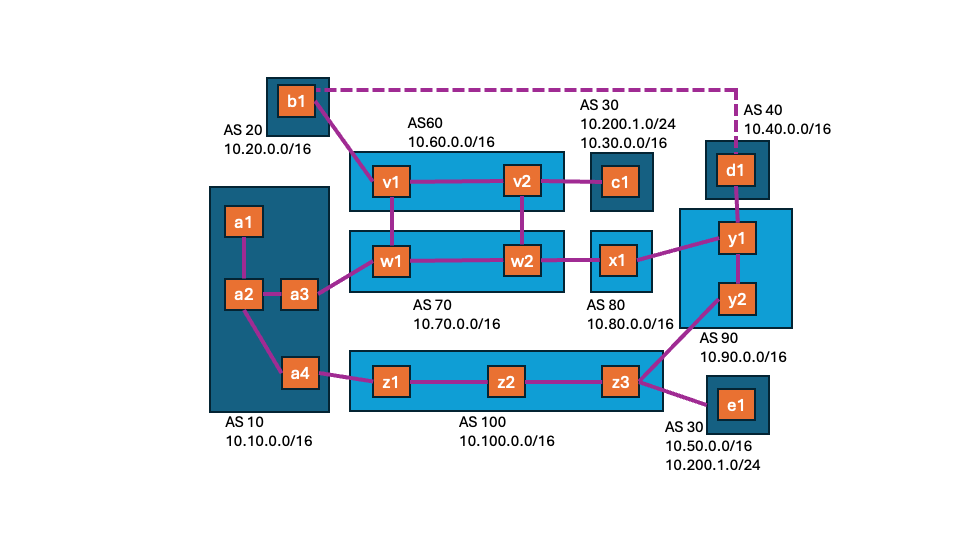

# Hands-On with Routing

The objective of this assignment is to demonstrate BGP routing first-hand.


# Getting Started

## Maintain Your Repository

 Before beginning:
 - [Mirror the class repository](../01b-hw-private-repo-mirror), if you haven't
   already.
 - [Merge upstream changes](../01b-hw-private-repo-mirror#update-your-mirrored-repository-from-the-upstream)
   into your private repository.

 As you complete the assignment:
 - [Commit changes to your private repository](../01b-hw-private-repo-mirror#commit-and-push-local-changes-to-your-private-repo).


# Start the Network

File `bgp.cfg` contains a configuration file that describes a network with
18 routers in 10 ASes.  

Run the following command to create and start the network:

```bash
cougarnet --terminal=a3,b1,c1 bgp.cfg
```

If the command fails with warnings related to the underlying routing software,
please try running the following:

```bash
sudo systemctl stop frr
sudo systemctl start frr
```

Then try running the scenario again.

The network is illustrated in the following diagram:



Note the following in the diagram:

 - Transit networks: `v`, `w`, `x`, `y`, `z`
 - Stub networks: `a`, `b`, `c`, `d`, `e`
 - Each network is labeled with the prefix(es) that it announces.
 - Networks `a` and `e` both use autonmous system number (ASN) 30 and announce
   the prefix 10.200.1.0/24.

All routers are running both BGP and RIP.  BGP is the inter-AS protocol used
for announcing your own prefix(es) to other ASes and for learning prefixes from
other ASes.  RIP is the distance vector (DV) protocol, an intra-AS routing
protocol used by routers within your AS to learn where all the subnets are
within your AS.


# Exercises

Run the following command on router `a3`, to display its forwarding table:

```bash
ip route
```

The forwarding table displayed should look similar to the ones you viewed and
manipulated in the [Network Layer Homework](../05-hw-network-layer).  The
difference here is that the table includes entries that have been added by the
RIP and BGP routing engines.  The column third from the right indicates whether
the entry is from a directly-connected subnet ("link") or learned via RIP
("rip") or BGP ("bgp").

 1. How was the forwarding rule for 10.10.0.16/30 learned?

 2. How was the forwarding rule for 10.50.0.0/16 learned?

Now run the following command, which shows the *available* BGP routes for `a3`:

```bash
sudo vtysh -c 'show ip bgp vrf a3'
```

The format is a little different.  In this case, each row is a "route", the
"Network" column shows the IP prefix associated with the route, the "Path"
column shows the AS path associated with the route, and the "Next Hop" column
shows the BGP next hop associated with the route. Finally, an "i" to the left
of "Network" indicates that the route was learned via iBGP, and a ">" to the
left of "Network" indiciates that that route was selected as the "best" or
"preferred" route.

For convenience, the following is a mapping for "Next Hop" addresses shown:

 - 10.10.0.14 is the IP address for `w1`
 - 10.10.0.18 is the IP address for `z1`

 3. How many routes are shown for 10.50.0.0/16?

 4. How many ASes are in the AS path for the best route for 10.50.0.0/16?

 5. Which NEXT\_HOP router corresponds to the best route for 10.50.0.0/16?
    (See mapping above.)

 6. Was the best route for 10.50.0.0/16 learned via eBGP or iBGP?

For each of the exercises below, run the specified command(s) on the indicated
router(s) and then select which of the following BGP scenarios is being
exemplified.

 - *Anycast.*  A single IP prefix is announced by multiple network locations.
   When routing to the IP prefix, a router will select the path leading to the
   network location closest to it.
 - *Hot potato routing.*  When comparing two routes with equal AS path lengths,
   a router chooses the one with the closest `NEXT_HOP` attribute -- that is,
   the shortest way out of its own AS.
 - *Route filtering.*  A stub (non-transit) AS should only announce its own
   IP prefixes, and a transit AS should only accept IP prefixes from its stubs
   that originate at those stubs.
 - *Shortest AS path.*  When comparing two routes, a router chooses the one
   with the shortest AS path -- that is, the one consisting of the fewest ASNs.

Note that you can also use output of the `vtysh` command to help you answer the
questions, by substituting the name after "vrf" with the appropriate hostname
of the router whose routing tables you wish to view.  However, using
`traceroute` applies the forwarding tables, which were created by the routes.

Run the following command on router `a3`, to trace the route to `d1`:

```bash
traceroute 10.40.1.1
```

 7. Was the path taken the shortest, in terms of router hops?  Compare to
    the diagram above to help you answer.

 8. Which BGP scenario is exemplified with the previous command?

Run the following command on router `a3`, to trace the route to `c1`:

```bash
traceroute 10.30.1.1
```

Then run the following command on router `c1`, to trace the route to `a3`:

```bash
traceroute 10.10.1.3
```

 9. What do you notice about the route taken from `a3` to `c1` and the return
    path?

 10. Which BGP scenario is exemplified with the previous command?

Note: you can run the following commands on router `a3` (it actually doesn't
matter which virtual host you run it on) to see with more detail the difference
in routing table contents and routing decisions between `w1` and `w2`.

```bash
sudo vtysh -c 'show ip bgp vrf w1'
sudo vtysh -c 'show ip bgp vrf w2'
```

Run the following command on router `a3`, to trace the route to 10.200.1.1.

```bash
traceroute 10.200.1.1
```

Run the following command on router `b1`, to trace the route to 10.200.1.1.

```bash
traceroute 10.200.1.1
```

 11. What do you notice about the differences in the routes taken from each of
     these sources to the same destination IP address?

 12. Which BGP scenario is exemplified with the previous command?

Run the following command on router `c1`, to trace the route to `d1`:

```bash
traceroute 10.40.1.1
```

Run the following command on router `b1`, to trace the route to `d1`:

```bash
traceroute 10.40.1.1
```

 13. How does the AS path from `c1` to `d1` compare to possible paths shown on
     the diagram and that from `b1` to `d1`?

 14. Which BGP scenario is exemplified with the previous command?
